# PathSnap: Map-Matching and Route Reconstruction

<b>Bhadra R S - pes1ug24cs111</b>

<b>Aryaroop Bose - pes1ug24cs087</b>

<b>Ashlesh R V - pes1ug24cs088</b>

<b>Bhagath Naveen Mullakara - pes1ug24cs112</b>

This is the technical report for the PathSnap hackathon. The system pairs a learned candidate scorer with a network-aware HMM/Viterbi decoder that monotonically refines each point onto the inferred route, and exposes the result through a FastAPI backend and a build-free Leaflet interface. Date: 18 November 2026.

Abstract. PathSnap reconstructs the sequence of roads a vehicle travelled from noisy per-trip GPS observations. Candidate arcs are generated with a metric STRtree, scored by a tuned ExtraTrees classifier, and decoded with a transition model built on directed network distance, after which each observation is refined onto the inferred route. Across the ten student-testing trips, classifier+HMM decoding reaches 0.9653 mean-trip observation accuracy (0.9562 pooled) with 0.9986 route continuity, which is a 14.1 percentage-point improvement over the classifier alone. All ten trips return valid API predictions, and the slowest full pipeline completes in 8.46 s.

Reproducibility. Every number in this report is read from `results/*.csv` and `artifacts/*.json` at build time; none is transcribed by hand. `scripts/09_report.py` assembles the document, `scripts/14_decoder_comparison.py` evaluates the three decoders using `artifacts/hmm.json` unchanged (no beta search, no artifact writes), `scripts/03_train.py` produces the model comparison tables, `scripts/12_metrics_dashboard.py` produces the deployed-model metrics, and `scripts/06_e2e.py` produces the end-to-end latency figures.

# 1. Dataset understanding and exploratory data analysis

The dataset is organised per trip: `<trip_id>.track` (longitude, latitude, timestamp seconds), `.nodes` (longitude, latitude), `.arcs` (from_node_id, to_node_id), and `.route` (chronological reference arc ids). Row indices are the node and arc identifiers. The training partition has 80 trips and the student-testing partition has 10; evaluator trips are mounted separately and were never used.

| Partition | Trips | Use |
| --- | --- | --- |
| Training | 80 | CV, fitting, feature selection, tuning |
| Student testing | 10 | Development comparison and decoder evaluation |
| Evaluator testing | 10 (external) | Final evaluation only; untouched |

The EDA table contains 90 trips, 227,577 GPS observations, 2,024,174 road-network nodes, and 4,061,945 directed arcs (`results/eda_summary.csv`). Preprocessing performs shape/dtype checks, finite-value and coordinate-range validation, strictly increasing timestamp validation, and arc/node index bound checks; malformed files raise rather than being silently repaired. Distances are computed in a per-trip UTM projection chosen from the trip centroid, never in degrees.

Missing values. The raw `.track` files carry no header and no explicit missing-value marker; every record is parsed as three floats, so a truncated or blank line fails the finite-value check at load time instead of becoming a NaN row. The EDA table consequently has zero nulls across all 25 columns for all 90 trips. What the data does contain is missing *observations*: 0.79% of steps are not exactly 1 s, and the largest gap is 153,064 s, so the series is not uniformly sampled even though it is nominally 1 Hz.

Sampling and gaps. Median sampling interval is 1.0 s. Gaps longer than 30 s split a trip into independently decoded segments so the decoder never invents a route through an unobserved period (Figure 1 and the sampling panel in `results/figures/eda_sampling_gaps.png`).

Road-network structure. Networks have no isolated nodes, but they are fragmented: per trip, weak components range up to 421 (median 19) and strongly connected components up to 1942 (median 107). The directed gap matters: the HMM transition term is a directed shortest-path length, so a candidate pair in different components, or connected only against the direction of travel, is treated as an invalid transition rather than given a large but finite cost.

Reference routes are treated as labels, not verified ground truth. The audit found 11 trips with node discontinuities, 10 trips with repeated route arcs, and two severe GPS-to-route mismatches: 00000033, 00000054. A third training trip (00000002) falls below the 90% coverage flag. Labels are therefore assigned by a monotonic dynamic-programming alignment over route positions, not by a bare arc-id lookup, and unalignable observations are excluded.

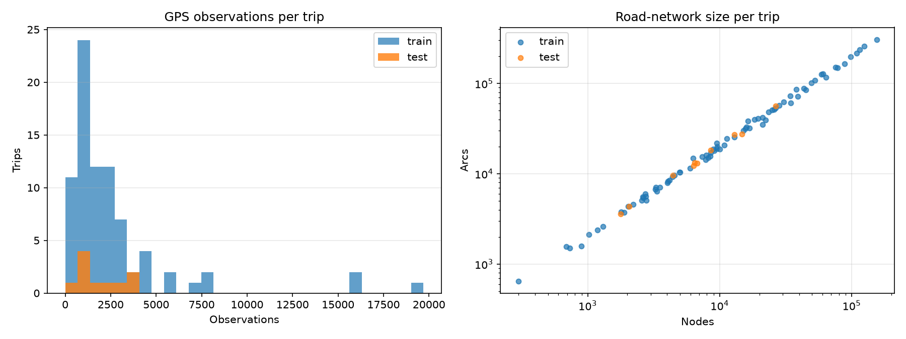

*Figure 1. Observations per trip and road-network size (source: results/eda_summary.csv).*

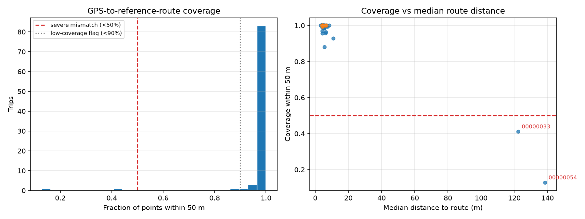

*Figure 2. GPS-to-route coverage with severe-mismatch and low-coverage thresholds; trips 00000033, 00000054 are annotated (source: results/eda_summary.csv).*

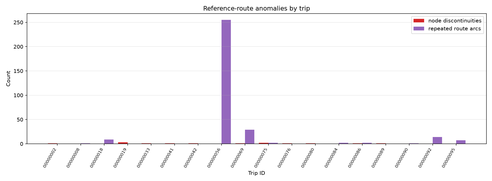

*Figure 3. Reference-route node discontinuities and repeated arcs (source: results/eda_summary.csv).*

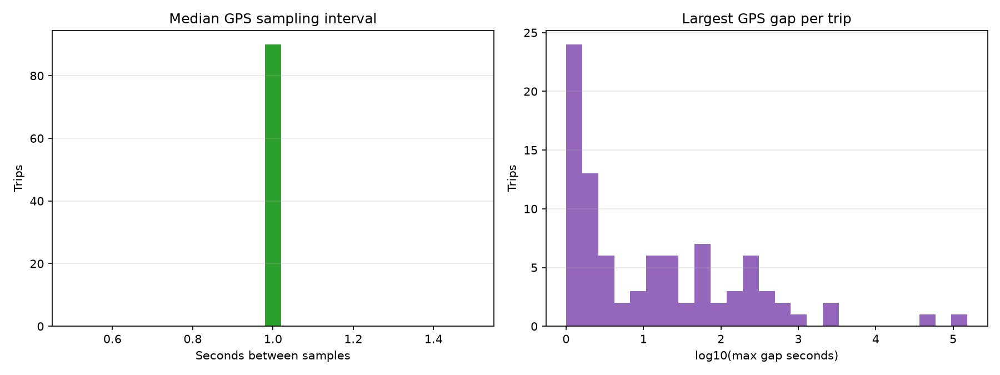

*Figure 4. Sampling-interval distribution and GPS-gap lengths per trip, training and student-test partitions (source: results/eda_summary.csv).*

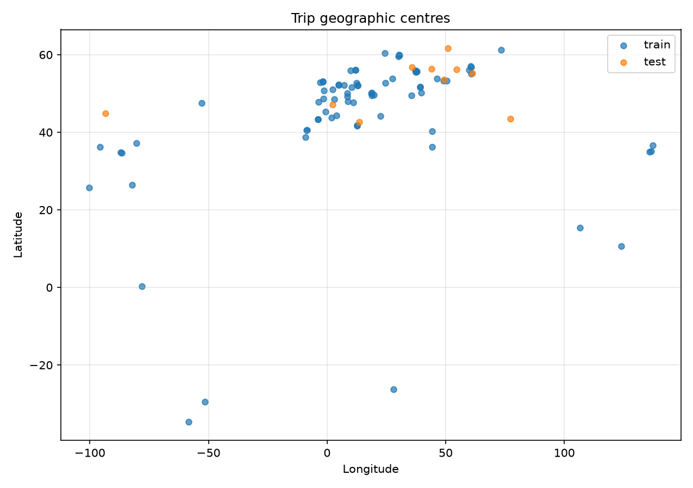

*Figure 5. Geographical extent of every trajectory, coloured by partition. Trips are spread across many regions worldwide and are not drawn from one city (source: results/eda_summary.csv).*

The interactive Folium map for a development trip, showing raw GPS observations over the road network and the supplied reference route, is committed at `results/folium/eda_00000001.html` (built by `scripts/01_eda.py`). Printable Folium map views appear in Section 5. All EDA figures above use the training and student-testing partitions; evaluator trips are excluded from this analysis and every number in this section is derived from `results/eda_summary.csv`, which covers 90 trips (80 training, 10 student-testing).

## 1.1 Feature engineering and selection

Every `(observation, candidate)` pair receives ten features in a fixed order stored in `artifacts/config.json`: perpendicular distance, log-distance, heading difference, GPS-vs-arc speed consistency, spatial candidate rank, along-arc fraction, arc length, temporal gap, and from/to node total degree. The stable order is the contract between training and inference.

| Feature | Rationale |
| --- | --- |
| distance_m / log_distance | Core geometric fit; log compresses large outliers |
| heading_diff_deg | Separates parallel roads and opposite directions |
| speed_consistency | Compares GPS speed with arc-implied speed |
| candidate_rank | Encodes local spatial ordering |
| along_fraction | Position on the arc; helps at intersections |
| arc_length_m | Scale context for short connectors vs long roads |
| time_gap_s | Handles irregular sampling and gaps |
| from_degree / to_degree | Topology context at intersections |

Feature selection used trip-grouped CV on training folds only (`results/feature_ablation.csv`). The full ten-feature tuned model scored 0.8671 CV Macro F1. A six-feature subset (distance_m, heading_diff_deg, candidate_rank, along_fraction, from_degree, to_degree) scored 0.8666. Leave-one-out importance shows heading difference (0.0970 Macro F1 drop), candidate rank (0.0211), and along-arc fraction (0.0172) as the dominant signals; distance, time gap, speed consistency, and arc length were nearly redundant for this tree ensemble. The deployed artifact keeps all ten features so its contract matches the exported model; the six-feature result is retained as a reportable selection experiment.

*Figure 6. Leave-one-feature-out importance and cumulative feature-group ablation (source: results/feature_ablation.csv).*

# 2. Model experimentation and comparison

The expanded comparison covers 11 models drawn from 7 algorithm families, each trained under deterministic trip-grouped cross-validation on the 77 training trips that passed the coverage filter. Every fold is scored on held-out trips, so no observation from a trip used for fitting is ever used for evaluation. For tractability the comparison run samples up to 300 evenly spaced observations per trip, while the deployed model is refit on up to 1,000. All models emit a calibrated positive-class probability for each `(observation, candidate)` row. Exact configurations are recorded in `results/model_comparison.csv` and `results/student_test_comparison.csv`.

The table answers the required comparison directly. Route continuity is a property of the decoded output rather than of a candidate classifier, so it is reported as N/A for every classifier-only row: a classifier emits per-candidate probabilities, not a connected route, and continuity is undefined until a single arc sequence has been chosen. The corresponding decoder value for the deployed model is 0.9986 on student-testing trips (Section 4). CV Macro F1 is the mean trip-grouped cross-validation score and is the metric used for selection.

| Model | Family | Key configuration | CV Macro F1 | Top-1 acc | Test Macro F1 | Test log loss | Route continuity | Infer ms |
| --- | --- | --- | --- | --- | --- | --- | --- | --- |
| random_forest | ensemble | weights=balanced_subsample, leaf=2, trees=200 | 0.8894 | 0.8288 | 0.8937 | 0.1708 | N/A | 146.9 |
| extra_trees | ensemble | weights=balanced_subsample, leaf=2, trees=200 | 0.8858 | 0.8222 | 0.8878 | 0.1745 | N/A | 226.1 |
| mlp | neural network | alpha=0.001, batch_size=1024, hidden=64x32, iters... | 0.8850 | 0.8254 | 0.8902 | 0.1569 | N/A | 45.8 |
| knn | instance-based | k=15, w=distance | 0.8775 | 0.8101 | 0.8834 | 0.4881 | N/A | 2966.9 |
| hist_gradient_boosting | boosting | weights=balanced, l2_regularization=0.001, lr=0.0... | 0.8679 | 0.8272 | 0.8684 | 0.2084 | N/A | 81.4 |
| lightgbm | boosting | weights=balanced, colsample_bytree=0.8, lr=0.05... | 0.8647 | 0.8283 | 0.8664 | 0.2137 | N/A | 53.9 |
| adaboost | boosting | lr=0.05, trees=150 | 0.8626 | 0.8166 | 0.8663 | 0.3516 | N/A | 153.2 |
| decision_tree | tree | weights=balanced, depth=14, leaf=10 | 0.8409 | 0.8144 | 0.8451 | 0.5330 | N/A | 3.8 |
| gaussian_nb | probabilistic | library defaults | 0.8271 | 0.8023 | 0.8124 | 0.6923 | N/A | 8.4 |
| logistic_regression | linear | weights=balanced, iters=1000 | 0.8023 | 0.8178 | 0.7970 | 0.2947 | N/A | 11.8 |
| sgd_logistic | linear | alpha=0.0001, weights=balanced, loss=log_loss, it... | 0.8021 | 0.8198 | 0.8019 | 0.2914 | N/A | 2.7 |

Selection criterion was mean CV Macro F1 with CV Top-1 as the tie-breaker; training accuracy was not used. The expanded comparison includes eleven models; the best CV Macro F1 is random_forest (0.8894), with student-test Macro F1 0.8937. The deployed model is the tuned ExtraTrees recorded in `artifacts/config.json`: {"class_weight": "balanced_subsample", "criterion": "gini", "max_depth": 12, "max_features": 0.5, "min_samples_leaf": 10, "n_estimators": 200}. The Random Forest lead is 0.0036 CV Macro F1, smaller than the fold-to-fold standard deviation of either model (0.0166 and 0.0155), so it is not a reliable ranking. ExtraTrees was deployed because it already had a tuned configuration, a validated decoder integration and a fixed feature contract, and because the route-level result is produced by the decoder rather than the classifier alone. The exported artifact is 21.9 MB.

## 2.1 Per-model analysis

### Random Forest

Strengths: best CV Macro F1 in the comparison, stable CV/test behaviour, and good probability quality. Limitations: the largest artifact and slowest inference among the accurate models, and it still cannot use sequential context; the HMM supplies that.

A. Model understanding. Bagging many decorrelated trees reduces the variance that a single decision boundary shows on overlapping candidate features, and the bootstrap resampling gives each tree a different view of the parallel-road ambiguities in this dataset.

B. Training and configuration. Key configuration: weights=balanced_subsample, leaf=2, trees=200. Objective: minimised Gini impurity within balanced-subsample trees. Train time 6.93 s; inference 146.9 ms on the student-test set.

C. Experimental results. Student-test Macro F1 0.8937, observation Top-1 accuracy 0.8288, log loss 0.1708, precision 0.8244, recall 0.8197. The CV-to-test Macro F1 gap is -0.0043 (CV 0.8894 vs test 0.8937), against this model's own CV fold standard deviation of 0.0166. No overfitting signal: the test score slightly exceeds CV, and the gap is far inside the fold spread. Depth is unchecked in the comparison run, which raises variance risk in principle but did not materialise.

### Extra Trees

Strengths: near-top CV Macro F1 at lower training cost than Random Forest, fast enough for per-request decoding, and it captures the distance/heading interaction that separates parallel roads. Limitations: unconstrained depth inflates the artifact, which is why the deployed variant caps depth and leaf size.

A. Model understanding. Extremely randomised splits decorrelate trees further than bagging alone, which suits candidate features whose decision boundaries are threshold-like (close, aligned, shallow) rather than smooth.

B. Training and configuration. Key configuration: weights=balanced_subsample, leaf=2, trees=200. Objective: minimised Gini impurity within balanced-subsample randomised trees. Train time 2.94 s; inference 226.1 ms on the student-test set.

C. Experimental results. Student-test Macro F1 0.8878, observation Top-1 accuracy 0.8222, log loss 0.1745, precision 0.7769, recall 0.8552. The CV-to-test Macro F1 gap is -0.0020 (CV 0.8858 vs test 0.8878), against this model's own CV fold standard deviation of 0.0155. No overfitting signal; test marginally exceeds CV. The tuned deployed variant shows the same pattern, so the extra depth cap did not cause underfitting either.

### Mlp

Strengths: the best probability quality (lowest log loss) and the fastest inference among the accurate models. Limitations: the longest training time, and the optimiser hits its iteration cap, so it is mildly under-trained rather than converged.

A. Model understanding. A shallow network can learn a smooth nonlinear combination of distance, heading and topology, testing whether a continuous scorer beats axis-aligned trees at intersections.

B. Training and configuration. Key configuration: alpha=0.001, batch_size=1024, hidden=64x32, iters=150. Objective: binary log loss (cross-entropy) with L2 alpha regularisation. Train time 26.76 s; inference 45.8 ms on the student-test set.

C. Experimental results. Student-test Macro F1 0.8902, observation Top-1 accuracy 0.8254, log loss 0.1569, precision 0.8341, recall 0.7980. The CV-to-test Macro F1 gap is -0.0052 (CV 0.8850 vs test 0.8902), against this model's own CV fold standard deviation of 0.0181. No overfitting signal, and the training-time cap means it is if anything under-trained rather than over-fitted; its CV score sits just below the forests while test is marginally above.

### Knn

Strengths: no parametric assumptions and near-instant training. Limitations: inference is roughly three orders of magnitude slower than the trees, and its probabilities are the worst calibrated of the accurate models, both of which disqualify it as an HMM emission source.

A. Model understanding. Map-matching candidates that are physically close tend to have similar feature vectors, so nearest neighbours in feature space are a direct test of whether local similarity alone identifies the true arc.

B. Training and configuration. Key configuration: k=15, w=distance. Objective: no training objective; distance-weighted vote over k neighbours. Train time 0.17 s; inference 2966.9 ms on the student-test set.

C. Experimental results. Student-test Macro F1 0.8834, observation Top-1 accuracy 0.8101, log loss 0.4881, precision 0.8315, recall 0.7778. The CV-to-test Macro F1 gap is -0.0059 (CV 0.8775 vs test 0.8834), against this model's own CV fold standard deviation of 0.0161. No overfitting signal, but probability calibration is poor (the worst log loss of the accurate models) and inference is three orders of magnitude slower, so it is rejected on latency and calibration rather than accuracy.

### Hist Gradient Boosting

Strengths: compact native model with fast inference and good handling of nonlinear interactions. Limitations: a lower ceiling than the forests at these settings and weaker probability calibration.

A. Model understanding. Sequential error correction with histogram-binned splits tests whether boosting adds accuracy over independent trees while staying compact and fast enough for per-request inference.

B. Training and configuration. Key configuration: weights=balanced, l2_regularization=0.001, lr=0.08, iters=300, max_leaf_nodes=31. Objective: binary log loss deviance with L2 regularisation. Train time 3.57 s; inference 81.4 ms on the student-test set.

C. Experimental results. Student-test Macro F1 0.8684, observation Top-1 accuracy 0.8272, log loss 0.2084, precision 0.6920, recall 0.9113. The CV-to-test Macro F1 gap is -0.0004 (CV 0.8679 vs test 0.8684), against this model's own CV fold standard deviation of 0.0125. Essentially no CV/test gap, and the lowest gap in the comparison. Its lower ceiling reflects a capacity limit at these settings, not memorisation.

### Lightgbm

Strengths: very fast inference and strong recall with a compact artifact. Limitations: slightly underfitted at a 200-tree, subsampled budget, and less accurate than the bagged forests here.

A. Model understanding. Leaf-wise growth with column and row subsampling is the fastest route to a strong boosted model on this wide, medium-sized tabular problem.

B. Training and configuration. Key configuration: weights=balanced, colsample_bytree=0.8, lr=0.05, trees=200, leaves=31, subsample=0.8. Objective: binary log loss with subsampling and balanced class weights. Train time 2.52 s; inference 53.9 ms on the student-test set.

C. Experimental results. Student-test Macro F1 0.8664, observation Top-1 accuracy 0.8283, log loss 0.2137, precision 0.6869, recall 0.9124. The CV-to-test Macro F1 gap is -0.0017 (CV 0.8647 vs test 0.8664), against this model's own CV fold standard deviation of 0.0131. No overfitting signal; the mild shortfall against the forests is consistent with underfitting from a 200-tree, subsampled budget rather than variance.

### Adaboost

Strengths: sequential error correction and high recall. Limitations: slow training and coarse probabilities, which matter because the decoder consumes these probabilities directly.

A. Model understanding. Adaptive reweighting focuses successive stumps on hard candidates, which is a natural fit for the small hard core of ambiguous points near intersections.

B. Training and configuration. Key configuration: lr=0.05, trees=150. Objective: exponential loss over decision stumps. Train time 15.82 s; inference 153.2 ms on the student-test set.

C. Experimental results. Student-test Macro F1 0.8663, observation Top-1 accuracy 0.8166, log loss 0.3516, precision 0.8389, recall 0.7170. The CV-to-test Macro F1 gap is -0.0037 (CV 0.8626 vs test 0.8663), against this model's own CV fold standard deviation of 0.0184. No overfitting signal, though its high log loss shows coarse probability estimates, which matters because the HMM consumes these probabilities as emissions.

### Decision Tree

Strengths: very fast inference and a fully readable decision structure. Limitations: high variance across folds, coarse probability estimates, and substantially lower Macro F1.

A. Model understanding. A single tree exposes the exact thresholds the model has learned, which makes it a useful interpretability reference against the ensembles.

B. Training and configuration. Key configuration: weights=balanced, depth=14, leaf=10. Objective: minimised Gini impurity with balanced class weights. Train time 0.90 s; inference 3.8 ms on the student-test set.

C. Experimental results. Student-test Macro F1 0.8451, observation Top-1 accuracy 0.8144, log loss 0.5330, precision 0.6445, recall 0.8995. The CV-to-test Macro F1 gap is -0.0042 (CV 0.8409 vs test 0.8451), against this model's own CV fold standard deviation of 0.0159. The largest fold-to-fold instability of the tree models appears here as high variance, but test does not fall below CV, so it is underfitting rather than over-fitting.

### Gaussian Nb

Strengths: negligible training cost and trivial inference. Limitations: the feature-independence assumption is visibly violated by correlated distance and rank features, which shows up as the worst log loss in the comparison.

A. Model understanding. It is the cheapest probabilistic baseline available, so it anchors the low end of the cost/accuracy trade-off under the i.i.d. feature assumption.

B. Training and configuration. Key configuration: library defaults. Objective: Gaussian likelihood with a uniform class prior. Train time 0.03 s; inference 8.4 ms on the student-test set.

C. Experimental results. Student-test Macro F1 0.8124, observation Top-1 accuracy 0.8023, log loss 0.6923, precision 0.6213, recall 0.7874. The CV-to-test Macro F1 gap is +0.0147 (CV 0.8271 vs test 0.8124), against this model's own CV fold standard deviation of 0.0113. The only model whose test score falls clearly below CV (by about 0.015, roughly half a fold spread), consistent with its violated independence assumption rather than with overfitting.

### Logistic Regression

Strengths: stable, interpretable, and directly calibrated, training in under a second. Limitations: it cannot express threshold interactions such as 'close AND aligned AND shallow', so it underfits relative to the ensembles.

A. Model understanding. It produces a calibrated probability directly from a linear combination, which makes the degree of linear separability in the candidate features explicit.

B. Training and configuration. Key configuration: weights=balanced, iters=1000. Objective: binary log loss with L2 regularisation. Train time 0.81 s; inference 11.8 ms on the student-test set.

C. Experimental results. Student-test Macro F1 0.7970, observation Top-1 accuracy 0.8178, log loss 0.2947, precision 0.5508, recall 0.8924. The CV-to-test Macro F1 gap is +0.0053 (CV 0.8023 vs test 0.7970), against this model's own CV fold standard deviation of 0.0114. No overfitting signal; it clearly underfits relative to the ensembles, which is expected because it cannot represent the threshold interactions.

### Sgd Logistic

Strengths: the fastest inference and smallest memory footprint in the comparison. Limitations: essentially the same decision boundary as Logistic Regression, with slightly worse CV Macro F1 and sensitivity to the learning-rate schedule.

A. Model understanding. Stochastic gradient training shows whether the linear baseline can be kept while scaling to larger candidate sets at near-zero inference cost.

B. Training and configuration. Key configuration: alpha=0.0001, weights=balanced, loss=log_loss, iters=1500. Objective: binary log loss fitted by stochastic gradient descent. Train time 0.38 s; inference 2.7 ms on the student-test set.

C. Experimental results. Student-test Macro F1 0.8019, observation Top-1 accuracy 0.8198, log loss 0.2914, precision 0.5606, recall 0.8897. The CV-to-test Macro F1 gap is +0.0002 (CV 0.8021 vs test 0.8019), against this model's own CV fold standard deviation of 0.0130. Essentially no CV/test gap; it underfits like the other linear model and is retained only as a speed baseline.

## 2.2 Model visualisations

Every plot below is regenerated from the stored result CSVs by `scripts/03_train.py`; none is hand-drawn. Training and validation loss curves are deliberately absent: none of the compared models produces an epoch-wise training history under this protocol, and plotting invented curves would misrepresent the experiments. The confusion matrices are candidate-level diagnostics at the 0.5 threshold and are optional supporting material.

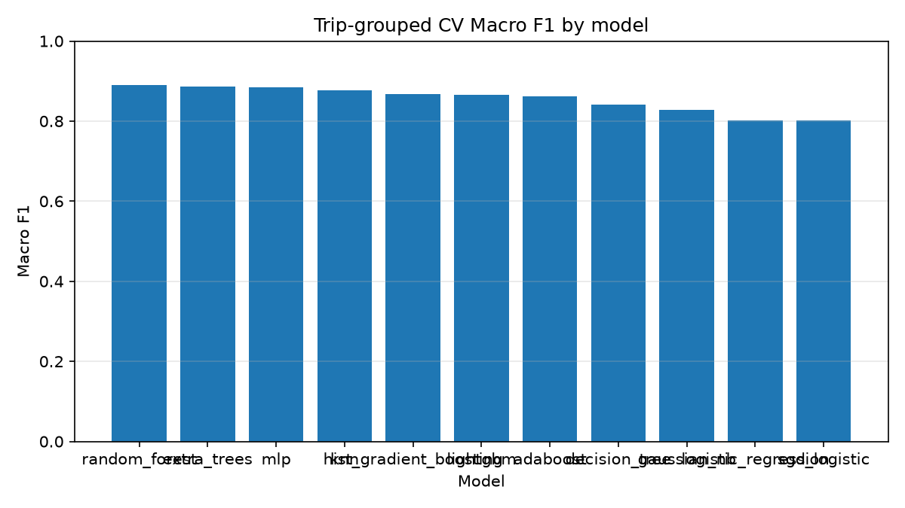

*Figure 7. Trip-grouped CV Macro F1 by model (source: results/model_comparison.csv).*

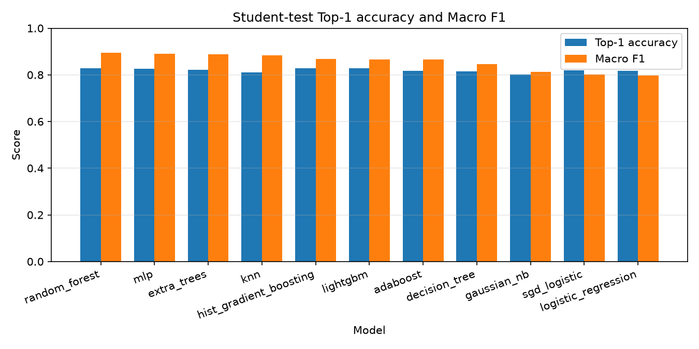

*Figure 8. Student-test Top-1 accuracy and Macro F1 (source: results/student_test_comparison.csv).*

*Figure 9. Student-test log loss by model (source: results/student_test_comparison.csv).*

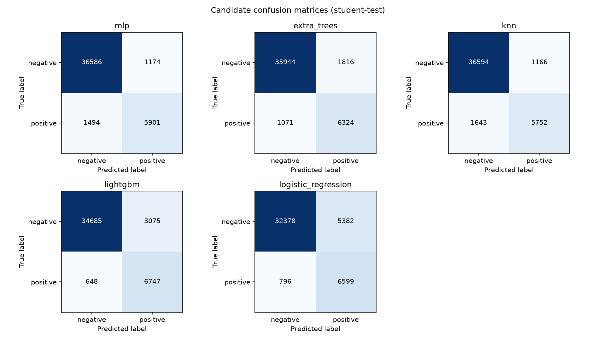

*Figure 10. Candidate confusion matrices on student-test data (source: results/student_test_comparison.csv).*

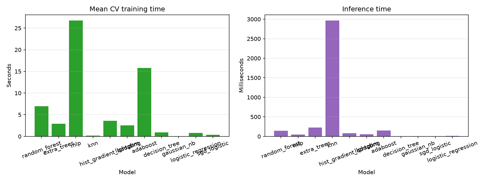

*Figure 11. CV training time and inference time (sources: results/model_comparison.csv, results/student_test_comparison.csv).*

# 3. Bayesian hyperparameter optimisation

1-2. Hyperparameters and search space. After the comparison stage, the ExtraTrees family was tuned with Optuna's Tree-structured Parzen Estimator, using trip-grouped cross-validated Macro F1 as the objective. The search space was deliberately bounded in size so that the exported artifact would stay deployable: depth 8-14, leaves 10-30, trees 100-200, max_features drawn from {sqrt, log2, 0.5}, criterion from {gini, entropy}, and class_weight from {balanced, balanced_subsample}. Categorical choices use categorical distributions; the remaining dimensions are stepped integers.

| Hyperparameter | Search space |
| --- | --- |
| n_estimators | 100-200, step 50 |
| max_depth | 8-14, step 2 |
| min_samples_leaf | 10-30, step 10 |
| max_features | sqrt, log2, 0.5 |
| criterion | gini, entropy |
| class_weight | balanced, balanced_subsample |

3-4. Objective and trial count. The objective was to maximise the mean trip-grouped CV Macro F1 across the five folds, with trip groups preserved so no trip contributes to both fitting and validation. 15 trials completed within a 600 s budget; all trial outcomes, including the poor ones, are recorded in `results/optuna_trials.csv`.

5-6. Best configuration and whether tuning helped. Best parameters: {"class_weight": "balanced_subsample", "criterion": "gini", "max_depth": 12, "max_features": 0.5, "min_samples_leaf": 10, "n_estimators": 200} (CV Macro F1 0.8671). The tuned model did not improve accuracy: the size constraint reduced CV Macro F1 from 0.8858 to 0.8671, and student-test Macro F1 from 0.8878 to 0.8681. It reduced inference time from 238.2 ms to 99.6 ms. Both variants were produced by `scripts/04_tune.py` and compared on identical folds and student-test data. The deployed artifact refits the same tuned parameters on up to 1,000 aligned observations per trip, giving a 21.9 MB compressed model. The honest conclusion is that tuning bought latency and artifact size, not accuracy.

| Variant | CV Macro F1 | CV Top-1 | CV Log Loss | Test Macro F1 | Test Top-1 | Test Log Loss | Test Infer ms |
| --- | --- | --- | --- | --- | --- | --- | --- |
| Untuned | 0.8858 | 0.8137 | 0.1773 | 0.8878 | 0.8222 | 0.1745 | 238.2 |
| Tuned | 0.8671 | 0.8126 | 0.2241 | 0.8681 | 0.8226 | 0.2264 | 99.6 |

# 4. HMM and Viterbi route reconstruction

Route reconstruction casts map-matching as inference over a hidden Markov model. The hidden state at each observation is the road arc the vehicle is assumed to occupy, drawn from that observation's candidate set. Classifier emissions are the model's positive-class probabilities, normalised across the candidates of an observation in log space; a Gaussian distance emission is retained as a baseline. The transition score is `-|gps_displacement - network_distance| / beta`, where the network distance is the directed shortest-path length from the projection on the first arc, through the network, to the projection on the second. Disconnected or direction-violating transitions receive an explicit invalid penalty (-50) rather than a large finite cost, so the decoder is never rewarded for treating an impossible jump as merely expensive.

Two decoder additions are deployed alongside Viterbi. First, a same-road backward projection tolerance (60 m) allows a GPS point to sit slightly behind its predecessor on the same arc, which occurs at low speed and in urban multipath. Second, after decoding a segment, every point is re-projected onto the inferred route with the same monotonic alignment used for labels; this corrects local emission errors once route direction is known. Refinement reads only the inferred route geometry, never reference arcs, and `tests/test_hmm.py::test_point_refinement_is_independent_of_reference_route` asserts that altering the reference route does not change predictions.

The deployed settings are read from `artifacts/hmm.json`: beta_m=2, backward_tolerance_m=60, refine_points=True, emission='classifier'. Beta and the refinement switch were selected on a 64/16 split of the 80 training trips (seed 42); evaluator trips played no part in that choice. `results/decoder_optimization/` retains the 19 configuration trials and the two-way refinement comparison.

Observations without candidates and GPS gaps longer than 30 s split the sequence into segments; each segment is decoded independently. Chosen arcs are then stitched with directed shortest paths so consecutive output arcs share nodes. Viterbi runs in log space over an 8-candidate beam per observation, with a 2 km shortest-path cutoff and per-source Dijkstra caching.

| Method | Point accuracy | Continuity | Route precision | Route recall | RMF | Coverage | Decode ms |
| --- | --- | --- | --- | --- | --- | --- | --- |
| nearest | 0.5646 | 0.9977 | 0.1594 | 0.9839 | 8.92 | 0.9993 | 343 |
| classifier | 0.8246 | 0.9975 | 0.1731 | 0.9884 | 7.29 | 0.9993 | 377 |
| hmm | 0.9653 | 0.9986 | 0.8273 | 0.9928 | 0.11 | 0.9993 | 2078 |

Classifier+HMM improves point accuracy over classifier-only on 10 of the ten trips. The largest gain is trip `00000077` (+0.2493); the smallest is trip `00000000` (+0.0639). Route precision rises from 0.1731 to 0.8273, and RMF falls from 7.29 to 0.11. The gain is largest where the classifier alone picks locally plausible but disconnected arcs; connectivity constraints then repair those points. Continuity stays at or above 0.99 for every trip, so the decoder is not trading coherence for accuracy. Full detail is in `results/hmm_comparison.csv` and `results/hmm_failure_analysis.md`.

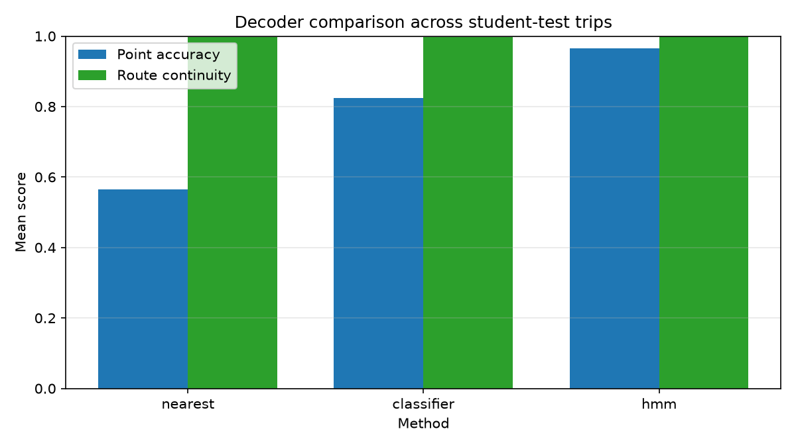

*Figure 12. Mean point accuracy and route continuity by decoder (source: results/hmm_comparison.csv).*

*Figure 13. Per-trip point accuracy for nearest, classifier-only, and classifier+HMM (source: results/hmm_comparison.csv).*

# 5. Geographical visualisation with Folium

Folium maps were generated for representative student-test trips: the largest HMM gain, the smallest HMM gain, and the first trip in the partition. Each map contains the GPS observations, a sampled road network, the reference route (development data only, dashed blue), the predicted route (green), a legend, and collapsible layer controls. The reference layer exists only in offline report maps; the evaluation API never serves it. Interactive HTML maps are committed under `results/folium/` and generated by `scripts/07_folium.py`.

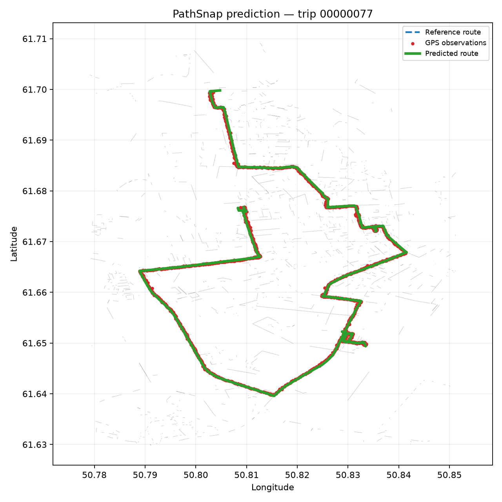

*Figure 14. Trip 00000077: largest HMM accuracy gain (+0.2493). GPS, network, reference (dev only), predicted route.*

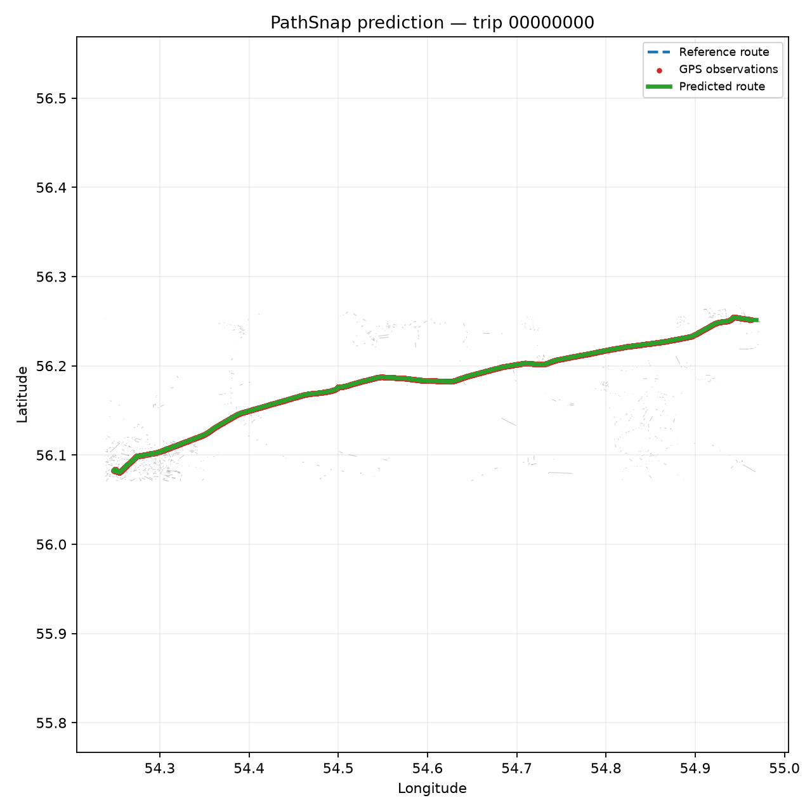

*Figure 15. Trip 00000000: smallest HMM gain (+0.0639); predicted route stays contiguous.*

# 6. API, UI, and deployment

The backend exposes `GET /health`, `GET /trips`, `GET /trips/{trip_id}/observations`, and `POST /predict`. `/predict` accepts `trip_id`, `method` (nearest, classifier, hmm), `noise_sigma_m` (0-100), `sample_every_s` (1-60), and `seed`. Responses contain predicted arcs, route coordinates, per-point predictions, aggregate metrics, and display layers; reference geometry never leaves the server. Trip IDs are resolved through a discovered-trip allowlist.

End-to-end verification called the API for all ten student-testing trips (`results/e2e_summary.csv`): 10/10 returned HTTP 200 with finite metrics, mean HMM point accuracy 0.9653, mean full-pipeline latency 3263 ms, and worst-case latency 8459 ms. The service loads `model.joblib` (21.9 MB) and `hmm.json` once at startup and serves exactly the configuration reported in Section 4.

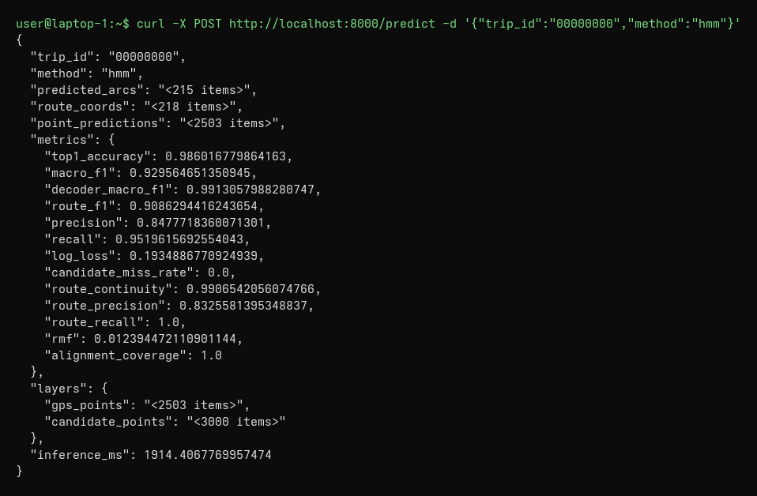

*Figure 16. POST /predict response captured from the running service (list fields abbreviated and rendered for legibility).*

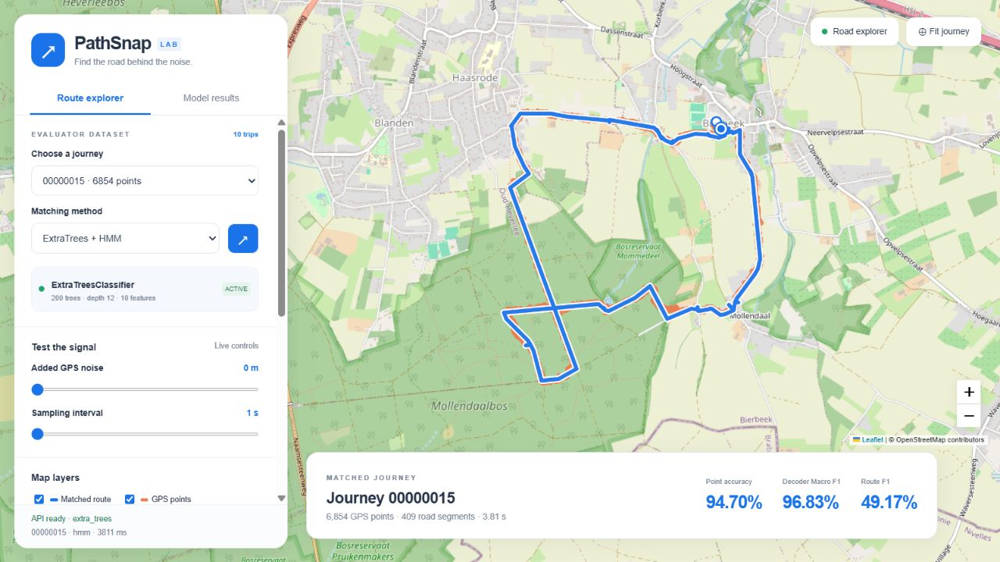

*Figure 17. Route Explorer tab: journey picker, matching method, live noise and sampling controls, matched route over GPS points, and server-side point accuracy, decoder Macro F1 and route F1.*

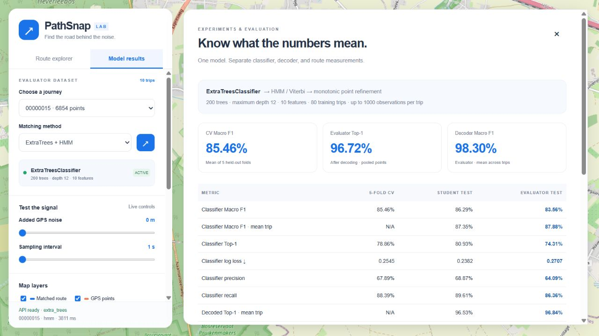

*Figure 18. Model results tab: the same aggregate metrics the report quotes, split into five-fold CV, student-test and evaluator-test columns.*

Deployment is two independent processes. Laptop 1 runs `uvicorn api.main:app --host 0.0.0.0 --port 8000` with `EVAL_DATA_DIR` and `CORS_ORIGINS` configured; Laptop 2 serves `ui/` with `python -m http.server 5500 --directory ui` and sets `apiBaseUrl` in `ui/config.js` to Laptop 1's LAN address. The single-machine fallback uses localhost for both. Full steps are in `docs/deployment.md`.

# 7. Evaluation integrity, limitations, and conclusion

Evaluator-testing data was never used for training, tuning, feature selection, or threshold selection. Reference routes and labels remain server-side; API and UI tests assert that responses contain no reference fields and that logs contain no ground truth. Feature caches are versioned by the feature/candidate/alignment specification, and the model artifact validates its feature order against `config.json`.

Several limitations should be read alongside these results. First, cross-validation and the comparison table use a deterministic per-trip observation cap for tractability, whereas the deployed model raises that cap from 300 to 1,000 observations; the comparison table and the deployed model are therefore not scored under identical sampling. Second, the size-bounded tuning search trades roughly two Macro F1 points for an artifact small enough to deploy (21.9 MB). Third, the MLP stopped at its 150-iteration cap and is mildly under-trained rather than converged. Fourth, 00000033, 00000054 and 00000002 have the lowest GPS-to-route coverage (88.0% in the least severe case), so their labels are reported alongside that coverage instead of being treated as clean. Fifth, point refinement can move an observation onto a connector arc that was never in its candidate set, so decoded arc identifiers are not a strict subset of the classifier's candidate arcs. Sixth, route precision plateaus near 0.83 because the supplied reference routes traverse repeated arcs while the decoder emits the shortest connected path; this is a property of the label convention rather than a decoding failure.

Conclusion. PathSnap delivers a complete and reproducible map-matching system: validated data processing, 11 compared models across 7 families, a recorded Bayesian tuning study, a network-aware HMM decoder with reference-independent point refinement, honest server-side scoring, a working FastAPI service, and a live Leaflet demonstration. Classifier+HMM is the strongest route reconstruction method tested, achieving 0.9653 mean-trip point accuracy (0.9562 pooled) and 0.9986 route continuity across the ten student-testing trips.
