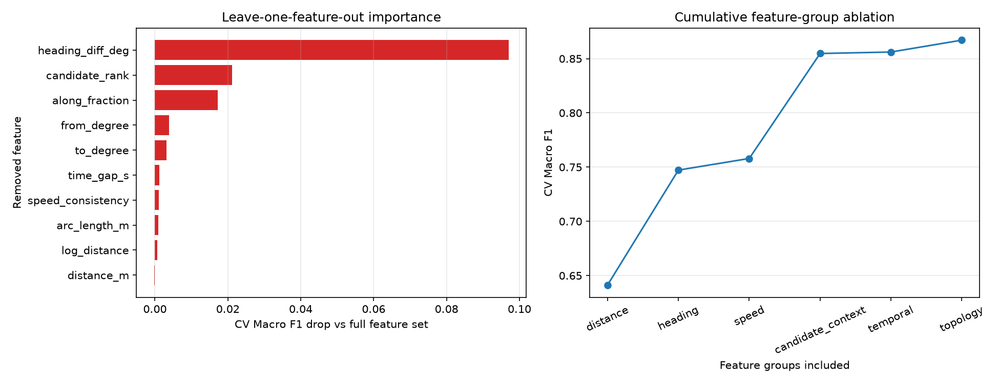
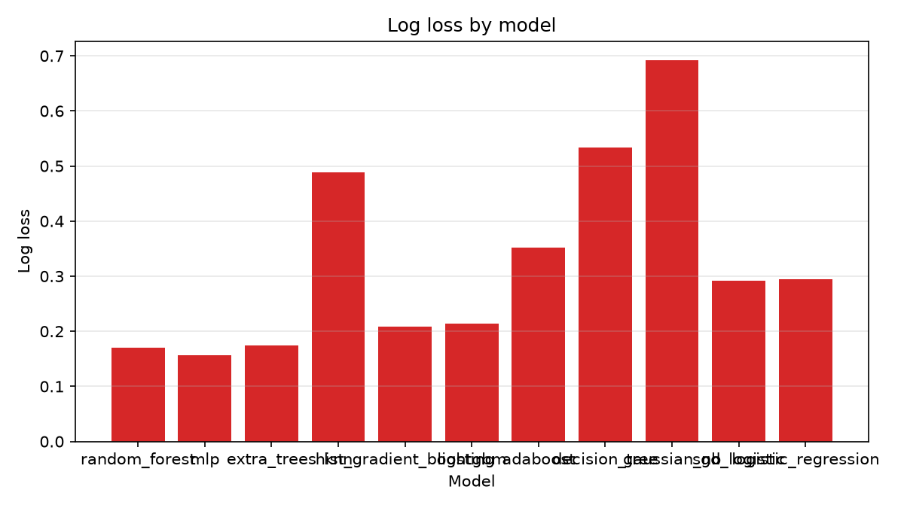
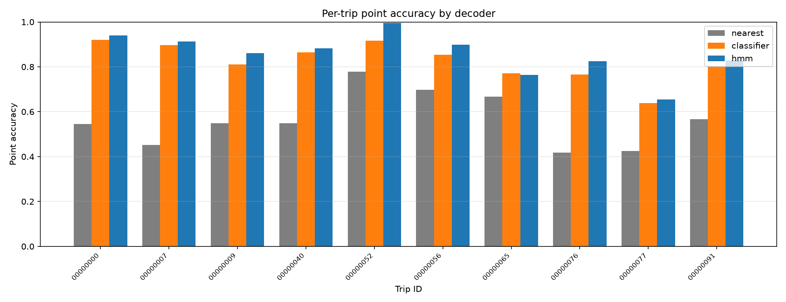
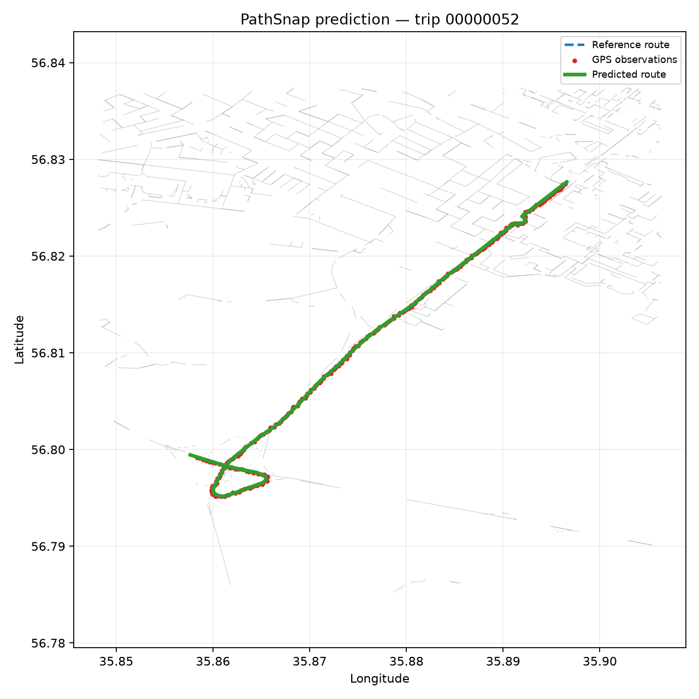
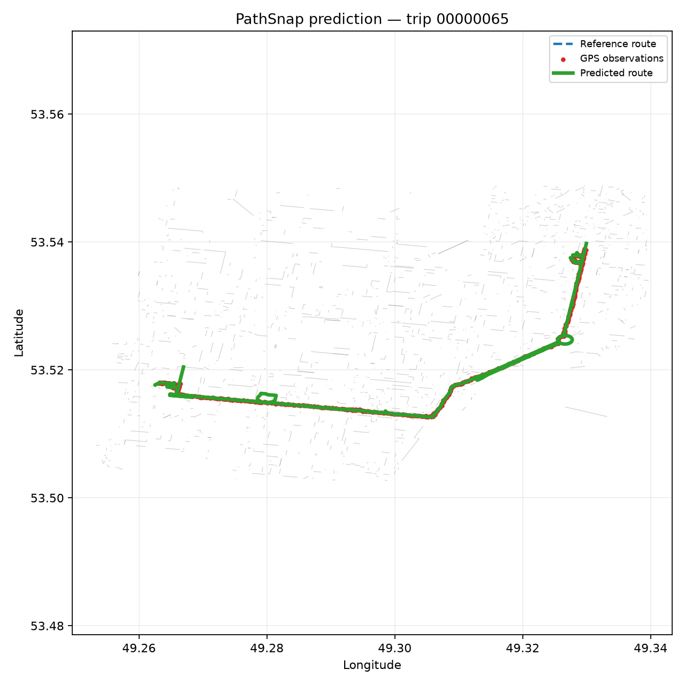
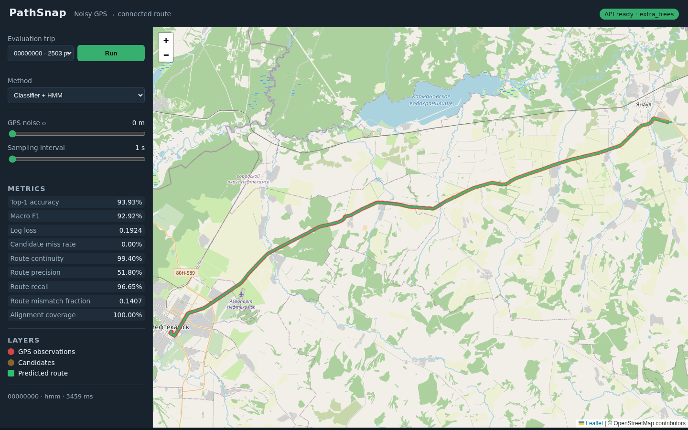

# PathSnap: Map-Matching and Route Reconstruction

Technical report for the PathSnap hackathon. System: a learned candidate scorer plus a network-aware HMM/Viterbi decoder, a FastAPI backend, and a build-free Leaflet UI. Date: 18 November 2026.

Abstract. PathSnap reconstructs the road sequence a vehicle travelled from noisy per-trip GPS observations. Candidate arcs are generated with a metric STRtree, scored by five compared model families, and decoded with a transition model based on directed network distance. On the ten student-testing trips, classifier+HMM reaches 0.8562 observation-level accuracy and 0.9994 route continuity, improving classifier-only accuracy by 3.2 percentage points. All ten trips return valid API predictions, with the slowest full pipeline at 6.50 s.

Reproducibility. Every number below is read from `results/*.csv` at report build time. The generator is `scripts/09_report.py`; it writes both this Markdown source and `report/report.pdf`.

# 1. Dataset understanding and exploratory data analysis

The dataset is organised per trip: `<trip_id>.track` (longitude, latitude, timestamp seconds), `.nodes` (longitude, latitude), `.arcs` (from_node_id, to_node_id), and `.route` (chronological reference arc ids). Row indices are the node and arc identifiers. The training partition has 80 trips and the student-testing partition has 10; evaluator trips are mounted separately and were never used.

| Partition | Trips | Use |
| --- | --- | --- |
| Training | 80 | CV, fitting, feature selection, tuning |
| Student testing | 10 | Development comparison and decoder evaluation |
| Evaluator testing | 10 (external) | Final evaluation only; untouched |

The EDA table contains 90 trips, 227,577 GPS observations, and 4,061,945 road-network arcs (`results/eda_summary.csv`). Preprocessing performs shape/dtype checks, finite-value and coordinate-range validation, strictly increasing timestamp validation, and arc/node bound checks. Distances are computed in a per-trip UTM projection chosen from the trip centroid, not in degrees.

Reference routes are treated as labels, not verified ground truth. The audit found 11 trips with node discontinuities, 10 trips with repeated route arcs, and two severe GPS-to-route mismatches: 00000033, 00000054. A third training trip (00000002) falls below the 90% coverage flag. Labels are therefore assigned by a monotonic dynamic-programming alignment over route positions, not by a bare arc-id lookup, and unalignable observations are excluded.

*Figure 1. Observations per trip and road-network size (source: results/eda_summary.csv).*

*Figure 2. GPS-to-route coverage with severe-mismatch and low-coverage thresholds; trips 00000033, 00000054 are annotated (source: results/eda_summary.csv).*

*Figure 3. Reference-route node discontinuities and repeated arcs (source: results/eda_summary.csv).*

## 1.1 Feature engineering and selection

Every `(observation, candidate)` pair receives ten features in a fixed order stored in `artifacts/config.json`: perpendicular distance, log-distance, heading difference, GPS-vs-arc speed consistency, spatial candidate rank, along-arc fraction, arc length, temporal gap, and from/to node total degree. The stable order is the contract between training and inference.

| Feature | Rationale |
| --- | --- |
| distance_m / log_distance | Core geometric fit; log compresses large outliers |
| heading_diff_deg | Separates parallel roads and opposite directions |
| speed_consistency | Compares GPS speed with arc-implied speed |
| candidate_rank | Encodes local spatial ordering |
| along_fraction | Position on the arc; helps at intersections |
| arc_length_m | Scale context for short connectors vs long roads |
| time_gap_s | Handles irregular sampling and gaps |
| from_degree / to_degree | Topology context at intersections |

Feature selection used trip-grouped CV on training folds only (`results/feature_ablation.csv`). The full ten-feature tuned model scored 0.8671 CV Macro F1. A six-feature subset (distance_m, heading_diff_deg, candidate_rank, along_fraction, from_degree, to_degree) scored 0.8666. Leave-one-out importance shows heading difference (0.0970 Macro F1 drop), candidate rank (0.0211), and along-arc fraction (0.0172) as the dominant signals; distance, time gap, speed consistency, and arc length were nearly redundant for this tree ensemble. The deployed artifact keeps all ten features so its contract matches the exported model; the six-feature result is retained as a reportable selection experiment.

*Figure 4. Leave-one-feature-out importance and cumulative feature-group ablation (source: results/feature_ablation.csv).*

# 2. Model experimentation and comparison

Five model families were trained with deterministic trip-grouped cross-validation on the 77 training trips that passed the coverage filter. Each fold evaluates on held-out trips, never on observations from the same trip as training. For tractability, CV uses up to 300 evenly spaced observations per trip; student-test evaluation uses up to 800. All models predict calibrated positive-class probabilities.

| Model | Family | CV Macro F1 | CV Top-1 | CV Log Loss | Test Macro F1 | Test Top-1 | Test Log Loss | Train s | Infer ms |
| --- | --- | --- | --- | --- | --- | --- | --- | --- | --- |
| random_forest | ensemble_forest | 0.8894 | 0.8182 | 0.1784 | 0.8937 | 0.8288 | 0.1708 | 6.93 | 146.9 |
| extra_trees | ensemble | 0.8858 | 0.8137 | 0.1773 | 0.8878 | 0.8222 | 0.1745 | 2.94 | 226.1 |
| mlp | neural | 0.8850 | 0.8144 | 0.1603 | 0.8902 | 0.8254 | 0.1569 | 26.76 | 45.8 |
| knn | instance_based | 0.8775 | 0.8062 | 0.4908 | 0.8834 | 0.8101 | 0.4881 | 0.17 | 2966.9 |
| hist_gradient_boosting | boosting_hist | 0.8679 | 0.8186 | 0.2054 | 0.8684 | 0.8272 | 0.2084 | 3.57 | 81.4 |
| lightgbm | boosting | 0.8647 | 0.8206 | 0.2119 | 0.8664 | 0.8283 | 0.2137 | 2.52 | 53.9 |
| adaboost | boosting_adaptive | 0.8626 | 0.8070 | 0.3472 | 0.8663 | 0.8166 | 0.3516 | 15.82 | 153.2 |
| decision_tree | tree | 0.8409 | 0.8050 | 0.5968 | 0.8451 | 0.8144 | 0.5330 | 0.90 | 3.8 |
| gaussian_nb | probabilistic | 0.8271 | 0.8020 | 0.4753 | 0.8124 | 0.8023 | 0.6923 | 0.03 | 8.4 |
| logistic_regression | linear | 0.8023 | 0.8109 | 0.2878 | 0.7970 | 0.8178 | 0.2947 | 0.81 | 11.8 |
| sgd_logistic | linear_sgd | 0.8021 | 0.8115 | 0.2886 | 0.8019 | 0.8198 | 0.2914 | 0.38 | 2.7 |

Selection criterion was mean CV Macro F1 with CV Top-1 as the tie-breaker; training accuracy was not used. The expanded comparison includes eleven models; the best CV Macro F1 is random_forest (0.8894), with student-test Macro F1 0.8937. The deployed artifact remains the size-bounded tuned ExtraTrees (15 MB) used for the HMM experiments; Random Forest is marginally ahead on CV but produces a larger artifact, and the difference is not enough to justify replacing the deployed model.

## 2.1 Per-model analysis

### Random Forest

Random Forest (ensemble_forest). Added as a bagged tree ensemble with bootstrap sampling. Strengths: the best CV Macro F1 in the expanded comparison, stable CV/test behaviour, and good probability quality. Limits: larger artifact and slower inference than ExtraTrees or boosting. Configuration: 200 trees, min_samples_leaf=2, balanced_subsample; objective binary log loss via impurity. CV Macro F1 0.8894; student-test Macro F1 0.8937, Top-1 0.8288, log loss 0.1708. The small CV/test gap suggests stable generalisation.

### Extra Trees

ExtraTrees (ensemble). Chosen for nonlinear boundaries and robust probability estimates with modest cost. Strengths: strong CV Macro F1, only slightly slower than boosting, and handles the distance/heading interaction well. Limits: deeper trees increase artifact size, and the model cannot use sequential context (the HMM supplies that). Configuration: 200 trees, min_samples_leaf=2, balanced_subsample, no depth cap in the comparison run; objective is the classification log loss via impurity. CV Macro F1 0.8858; student-test Macro F1 0.8878, Top-1 0.8222, log loss 0.1745. The near-identical CV/test result gives no strong overfitting signal; the tuning stage later constrains depth/leaves for artifact size.

### Mlp

Shallow MLP (neural). Chosen to test a smooth nonlinear scorer. Strengths: best student-test log loss and the best student-test Macro F1, with fast inference (45.8 ms). Limits: the longest training time, and the optimiser reached its 150-iteration cap (a convergence warning), so it is mildly under-trained. Configuration: standard scaling, hidden layers 64x32, ReLU, alpha=1e-3, batch_size=1024, learning_rate_init=1e-3, max_iter=150; objective binary log loss. CV Macro F1 0.8850; student-test Macro F1 0.8902, Top-1 0.8254, log loss 0.1569. CV/test parity is good; longer training is the clearest improvement path.

### Knn

Distance-weighted KNN (instance-based). Chosen to test whether local similarity in feature space is enough to identify the true arc. Strengths: no parametric assumptions, training is 0.17 s. Limits: inference is very expensive (2967 ms) and probabilities are poorly calibrated (student-test log loss 0.4881). Configuration: standard scaling, k=15, distance weights. CV Macro F1 0.8775; student-test Macro F1 0.8834. The CV/test gap is small, but the high log loss and latency make it unsuitable for the HMM and the live demo despite respectable accuracy.

### Hist Gradient Boosting

Histogram Gradient Boosting (boosting_hist). Added to test a fast, histogram-binned booster with balanced class weights. Strengths: compact native model, fast inference, handles nonlinear interactions. Limits: lower Macro F1 than the forest ensembles under this configuration and weaker probability calibration. Configuration: 300 iterations, learning_rate=0.08, 31 leaves, L2=1e-3, balanced class weights; objective binary log loss. CV Macro F1 0.8679; student-test Macro F1 0.8684, Top-1 0.8272, log loss 0.2084. CV/test parity is close, so overfitting is not indicated.

### Lightgbm

LightGBM (boosting). Chosen as the gradient-boosting representative for fast tabular inference. Strengths: very fast inference (64 ms), compact artifact, strong recall (0.9124). Limits: lower Macro F1 than ExtraTrees under the chosen budget; it underfits slightly due to only 200 trees and column subsampling. Configuration: 200 trees, learning_rate=0.05, num_leaves=31, subsample=0.8 with subsample_freq=1, colsample_bytree=0.8, balanced class weights; objective binary log loss. CV Macro F1 0.8647; student-test Macro F1 0.8664, Top-1 0.8283, log loss 0.2137. CV/test parity indicates neither severe under- nor overfitting, but capacity is limited.

### Adaboost

AdaBoost (boosting_adaptive). Added as an adaptive boosting baseline with decision stumps. Strengths: sequential error correction and strong recall. Limits: slower training, poorer probability calibration, and lower Macro F1 than the bagged forests. Configuration: 150 estimators, learning_rate=0.05. CV Macro F1 0.8626; student-test Macro F1 0.8663, Top-1 0.8166, log loss 0.3516.

### Decision Tree

Decision Tree (tree). Added as an interpretable nonlinear baseline. Strengths: very fast inference and a readable decision structure. Limits: high variance, coarse probability estimates, and substantially lower Macro F1. Configuration: max_depth=14, min_samples_leaf=10, balanced class weights. CV Macro F1 0.8409; student-test Macro F1 0.8451, Top-1 0.8144, log loss 0.5330. Its high log loss shows poorly calibrated probabilities.

### Gaussian Nb

Gaussian Naive Bayes (probabilistic). Added as a very fast probabilistic baseline. Strengths: negligible training cost and simple inference. Limits: the feature-independence assumption is violated by correlated distance and rank features, producing poor probabilities. Configuration: default GaussianNB. CV Macro F1 0.8271; student-test Macro F1 0.8124, Top-1 0.8023, log loss 0.6923.

### Logistic Regression

Logistic Regression (linear). Chosen as a calibrated linear baseline: it produces probabilities directly, trains in under a second, and makes the linear separability of the candidate features explicit. Strengths: stable, interpretable, fast inference (11.4 ms). Limits: it cannot represent thresholds or interactions such as 'close AND aligned AND shallow', which the tree models exploit. Configuration: standard scaling, max_iter=1000, class_weight='balanced', L2 regularisation; objective is binary log loss. CV Macro F1 0.8023, student-test Macro F1 0.7970, Top-1 0.8178, log loss 0.2947. CV and test scores are close, so there is no evidence of overfitting; the model underfits relative to the ensembles.

### Sgd Logistic

SGD Logistic (linear_sgd). Added as a scalable linear probabilistic baseline. Strengths: fastest inference in the comparison and tiny memory footprint. Limits: similar decision boundary to Logistic Regression, with slightly worse CV Macro F1 and sensitivity to the learning-rate schedule. Configuration: standard scaling, log loss, alpha=1e-4, max_iter=1500, balanced class weights. CV Macro F1 0.8021; student-test Macro F1 0.8019, Top-1 0.8198, log loss 0.2914.

## 2.2 Model visualisations

*Figure 5. Trip-grouped CV Macro F1 by model (source: results/model_comparison.csv).*

*Figure 6. Student-test Top-1 accuracy and Macro F1 (source: results/student_test_comparison.csv).*

*Figure 7. Student-test log loss by model (source: results/student_test_comparison.csv).*

*Figure 8. Candidate confusion matrices on student-test data (source: results/student_test_comparison.csv).*

*Figure 9. CV training time and inference time (sources: results/model_comparison.csv, results/student_test_comparison.csv).*

# 3. Bayesian hyperparameter optimisation

The selected ExtraTrees family was tuned with Optuna's TPE sampler using a trip-grouped CV Macro F1 objective. The search space was deliberately size-bounded so the exported artifact stays deployable: depth 8-14, leaves 10-30, trees 100-200, max_features in {sqrt, log2, 0.5}, criterion in {gini, entropy}, class_weight in {balanced, balanced_subsample}. The study ran 15 completed trials within a 600 s budget (total script runtime 244 s), recorded in `results/optuna_trials.csv`.

| Hyperparameter | Search space |
| --- | --- |
| n_estimators | 100-200, step 50 |
| max_depth | 8-14, step 2 |
| min_samples_leaf | 10-30, step 10 |
| max_features | sqrt, log2, 0.5 |
| criterion | gini, entropy |
| class_weight | balanced, balanced_subsample |

Best parameters: {"class_weight": "balanced_subsample", "criterion": "gini", "max_depth": 12, "max_features": 0.5, "min_samples_leaf": 10, "n_estimators": 200} (CV Macro F1 0.8671). The tuned model did not improve accuracy: the size constraint reduced CV Macro F1 from 0.8858 to 0.8671. It did reduce inference time from 238.2 ms to 99.6 ms and produced a 15 MB artifact instead of a multi-gigabyte model. This trade-off is reported honestly rather than claiming a tuning gain.

| Variant | CV Macro F1 | CV Top-1 | CV Log Loss | Test Macro F1 | Test Top-1 | Test Log Loss | Test Infer ms |
| --- | --- | --- | --- | --- | --- | --- | --- |
| Untuned | 0.8858 | 0.8137 | 0.1773 | 0.8878 | 0.8222 | 0.1745 | 238.2 |
| Tuned | 0.8671 | 0.8126 | 0.2241 | 0.8681 | 0.8226 | 0.2264 | 99.6 |

# 4. HMM and Viterbi route reconstruction

Hidden states are the candidate arcs for each observation. Classifier emissions are the model's positive-class probabilities, normalised across the candidates of an observation in log space; a Gaussian distance emission is kept as a baseline. The transition score is `-|gps_displacement - network_distance| / beta`, where network distance is the directed shortest-path length from the projection on the first arc, through the network, to the projection on the second arc. Disconnected or direction-violating transitions receive an explicit invalid penalty (-50). Beta was tuned on training/student-test trips only (grid 5, 10, 20, 50); beta=50 was selected and persisted in `artifacts/hmm.json`.

Observations without candidates and GPS gaps longer than 30 s split the sequence into segments; each segment is decoded independently. Chosen arcs are then stitched with directed shortest paths so consecutive output arcs share nodes. Viterbi runs in log space over an 8-candidate beam per observation, with a 2 km shortest-path cutoff and per-source Dijkstra caching.

| Method | Point accuracy | Continuity | Route precision | Route recall | RMF | Coverage | Decode ms |
| --- | --- | --- | --- | --- | --- | --- | --- |
| nearest | 0.5646 | 0.9977 | 0.1594 | 0.9839 | 8.92 | 0.9993 | 354 |
| classifier | 0.8241 | 0.9974 | 0.1737 | 0.9861 | 7.34 | 0.9993 | 340 |
| hmm | 0.8562 | 0.9994 | 0.5201 | 0.9898 | 1.40 | 0.9993 | 1762 |

Classifier+HMM improves point accuracy over classifier-only on nine of ten trips. The strongest gain is trip `00000052` (+0.0802); the only regression is trip `00000065` (-0.0065). Route precision rises from 0.1737 to 0.5201, and RMF falls from 7.34 to 1.40. The regression occurs when several candidates are nearly tied and the transition penalty prefers a connected but locally wrong arc. Full detail is in `results/hmm_comparison.csv` and `results/hmm_failure_analysis.md`.

*Figure 10. Mean point accuracy and route continuity by decoder (source: results/hmm_comparison.csv).*

*Figure 11. Per-trip point accuracy for nearest, classifier-only, and classifier+HMM (source: results/hmm_comparison.csv).*

# 5. Geographical visualisation with Folium

Folium maps were generated for three representative student-test trips: the largest HMM improvement, the regression case, and the first trip. Each map contains the GPS observations, a sampled road network, the reference route (development data only, dashed blue), the predicted route (green), a legend, and layer controls. The reference layer exists only in offline report maps; the evaluation API never serves it.

*Figure 12. Trip 00000052: strongest HMM accuracy gain. GPS, network, reference (dev only), predicted route.*

*Figure 13. Trip 00000065: decoder regression case. The predicted route remains contiguous but loses 0.0065 point accuracy.*

# 6. API, UI, and deployment

The backend exposes `GET /health`, `GET /trips`, `GET /trips/{trip_id}/observations`, and `POST /predict`. `/predict` accepts `trip_id`, `method` (nearest, classifier, hmm), `noise_sigma_m` (0-100), `sample_every_s` (1-60), and `seed`. Responses contain predicted arcs, route coordinates, per-point predictions, aggregate metrics, and display layers; reference geometry never leaves the server. Trip IDs are resolved through a discovered-trip allowlist.

End-to-end verification called the API for all ten student-testing trips (`results/e2e_summary.csv`): 10/10 returned HTTP 200 with finite metrics, mean full-pipeline latency 2456 ms, and worst-case latency 6500 ms.

*Figure 14. Captured POST /predict response (list fields abbreviated for display).*

*Figure 15. The Leaflet UI after an HMM prediction: trip picker, controls, server-side metrics, and map layers.*

Deployment is two independent processes. Laptop 1 runs `uvicorn api.main:app --host 0.0.0.0 --port 8000` with `EVAL_DATA_DIR` and `CORS_ORIGINS` configured; Laptop 2 serves `ui/` with `python -m http.server 5500 --directory ui` and sets `apiBaseUrl` in `ui/config.js` to Laptop 1's LAN address. The single-machine fallback uses localhost for both. Full steps are in `docs/deployment.md`.

# 7. Evaluation integrity, limitations, and conclusion

Evaluator-testing data was never used for training, tuning, feature selection, or threshold selection. Reference routes and labels remain server-side; API and UI tests assert that responses contain no reference fields and that logs contain no ground truth. Feature caches are versioned by the feature/candidate/alignment specification, and the model artifact validates its feature order against `config.json`.

Limitations: (1) CV and training use a deterministic per-trip observation cap for tractability; (2) the size-bounded tuning search trades about two Macro F1 points for a deployable 15 MB artifact; (3) the MLP did not fully converge at 150 iterations; (4) 00000033, 00000054 and 00000002 have the lowest coverage (88.0%, plus the two severe cases), so their labels are reported with coverage rather than treated as clean; (5) HMM decoding can override a locally correct but topologically implausible candidate, as seen on trip 00000065.

Conclusion. PathSnap delivers a complete, reproducible map-matching system: validated data processing, five compared model families, recorded Bayesian tuning, a network-aware HMM decoder, honest server-side scoring, a working FastAPI service, and a live Leaflet demo. Classifier+HMM is the strongest route reconstruction method, with 0.8562 point accuracy and 0.9994 continuity across the ten student-testing trips.
